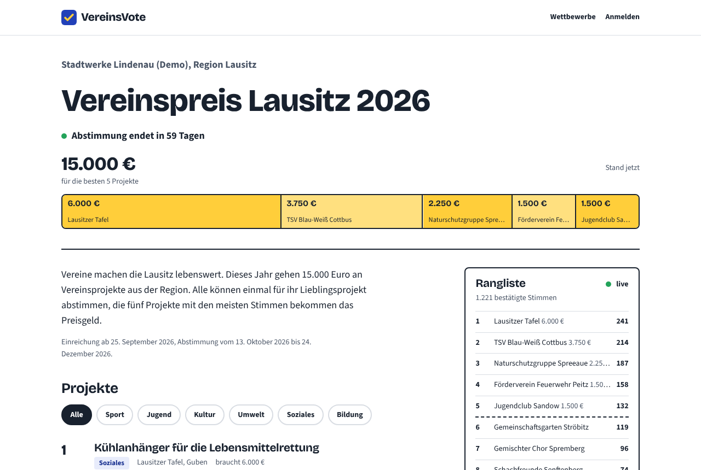
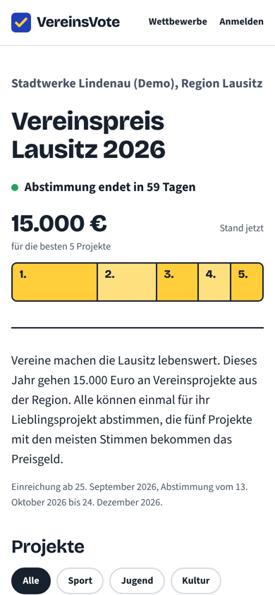
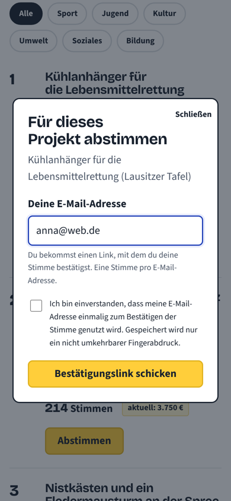
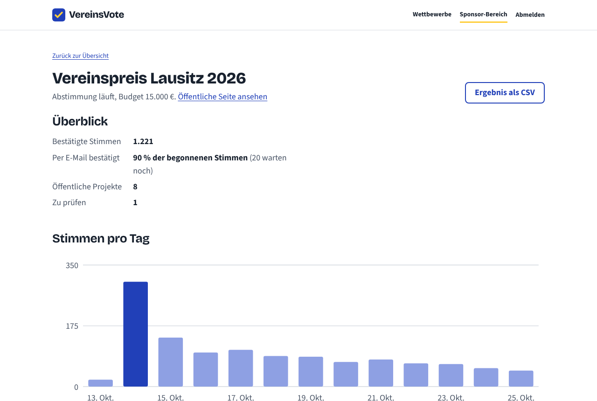

# VereinsVote

Crowdvoting for regional funding competitions. A company puts up a budget, local clubs (Vereine) submit projects, people vote, and the projects with the most votes share the money.

The interface is in German, because the users are German clubs and residents. Code and docs are in English.

Live demo: (https://vereinsvote.onrender.com/)

Demo logins (password `demo1234`): `sponsor@demo.vereinsvote.de` and `tsv@demo.vereinsvote.de`. The login page has buttons that fill them in.



## Features

- Voters browse projects and vote with only an email address, no account.
- Clubs register, submit one project per competition with an optional photo, and see their review status and votes.
- Sponsors create competitions (budget, prize split, dates), review projects before they go public, see votes per day and per category, and export the results as CSV.
- The bar at the top of a competition shows the budget split into the prizes, with the clubs that would get them if voting ended now. It updates live while people vote.

 



## How voting works

A vote is only counted after the voter clicks a link sent to their email. Before that it is stored as pending.

To keep it to one vote per person and competition:

- Postgres has a unique index on (competition, email hash), so a second vote fails in the database even if two requests arrive at the same moment.
- Emails are normalised first. For Gmail, `Anna.Muster+1@gmail.com` and `annamuster@googlemail.com` are the same inbox and count as one.
- The email itself is never stored, only an HMAC of the normalised address. That is enough to block a second vote and useless without the server secret.
- Confirming locks the vote row (`SELECT ... FOR UPDATE`) and increases the counter in the same transaction, so clicking a link five times at once still counts once. There is a test for this.

Against bots there is a per-IP rate limit, a hidden honeypot field and a small list of throwaway email providers. Behind a proxy only the proxy's own `X-Forwarded-For` entry is trusted, so the rate limit can't be bypassed by sending a fake header.

## Numbers

Measured with the code in this repo on a small 2-core VM, with Postgres and the load generator on the same machine:

| | |
| --- | --- |
| Full vote flow (start + confirm), 2,000 voters, 50 in parallel | 283 votes/s, p95 244 ms |
| Votes counted after that run | 2,000 of 2,000 |
| Leaderboard reads, 50 connections | 1,074 requests/s, p99 93 ms |
| Lighthouse (competition page) | mobile 92 / 100 / 96 / 100, desktop 100 / 100 / 96 / 100 |
| Tests | 67 (50 API against a real Postgres, 17 for the shared logic) |
| Server line coverage | 91.8 % |

The load test is `server/scripts/loadtest.ts`. Lighthouse columns are performance, accessibility, best practices and SEO.

## Stack and structure

TypeScript everywhere: Node.js 22, Fastify, PostgreSQL with Drizzle ORM, Zod, sharp for images, React 19 with React Router and Vite, Vitest. One Docker image, CI on GitHub Actions.

```
shared/   rules used by both sides: phases, ranking, payout split, Zod schemas, API types
server/   Fastify API, database schema, SQL migrations, tests, load test
web/      React app
docs/     design decisions, deployment, screenshots
```

The server also serves the built frontend, so the whole thing is one service and one database. The live ranking uses Server-Sent Events. Why I chose these, and what I'd change at a bigger scale, is in [docs/decisions.md](docs/decisions.md).

## Running it

With Docker:

```bash
docker compose up --build
# http://localhost:3000, demo data is created on the first start
```

Without Docker you need Node.js 22 and PostgreSQL:

```bash
npm install
cp .env.example .env        # change DATABASE_URL if needed
createdb vereinsvote
npm run db:seed             # runs the migrations and adds demo data
npm run dev                 # API on :3000, app on http://localhost:5173
```

Without an SMTP server the app runs in demo mode: instead of sending the confirmation email, the vote dialog shows the link. All settings are in [.env.example](.env.example).

The demo projects have no photos until you add some: put pictures with the names listed in [server/seed-photos/README.md](server/seed-photos/README.md) into that folder and run `npm run db:seed -- --reset`.


